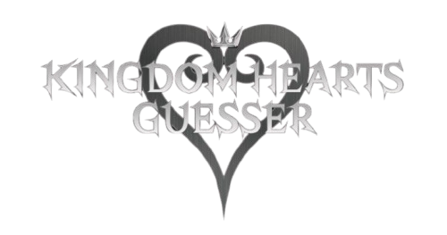

Test your knowledge of the Kingdom Hearts franchise and share your results with friends in this daily guessing game.

## About Kingdom Hearts Guesser

Kingdom Hearts Guesser is a web-game, built with Dart and using Flutter as a framework. Flutter was chosen simply to gain practice working with multi-platform application development.

Currently there are two modes with more planned:
- Character
- Keyblade

## ​Issues

Found a bug? Please report it [here](https://github.com/ciara1b/KH-Guesser/issues?q=is%3Aissue+is%3Aopen+label%3Abug) so we can fix it.

If you want to help [fix an issue](https://github.com/ciara1b/Guesser/labels/good%20first%20issue), contact me or open a pull request.

## Credit and thanks

Kingdom Hearts Guesser is developed and maintained by:

- Ciara (Zekrofire) - https://ciarabarry.ie/

:triangular_flag_on_post: Landing page character art by [miscfi](https://www.instagram.com/miscfi)